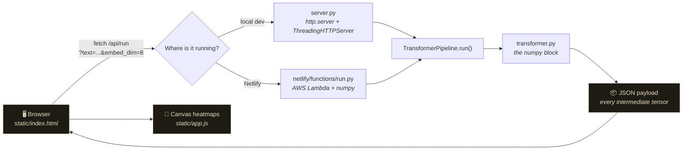
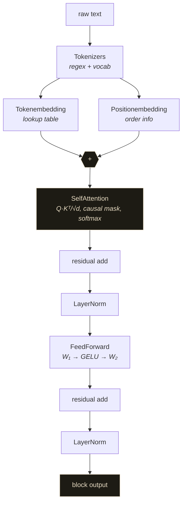

<div align="center">

# Transformer Visualizer

**A transformer block written from scratch in NumPy — with a live UI that shows you every tensor inside it.**

[Live demo](https://transformer-viz.netlify.app) · [Source](https://github.com/AKXLR8/transformer_in_numpy) · [Issues](https://github.com/AKXLR8/transformer_in_numpy/issues)

</div>

---

## What's this?

You know the transformer block from the papers — embeddings, self-attention, feed-forward, residual, LayerNorm. But reading about it and *seeing* it are two different things.

So this repo has two halves:

1. **`transformer.py`** — a single block built with nothing but NumPy. No PyTorch, no HuggingFace, no magic. Just matrices and `np.dot`.
2. **A browser UI** that runs that exact code and paints the results — the attention matrix, the embedding tables, the GELU activations, the shape of every intermediate.

Type a sentence, hit run, and watch the numbers move. Nothing is mocked up — the heatmaps are the actual NumPy arrays coming out of the actual code.

   

---

## Quick start

```bash
git clone https://github.com/AKXLR8/transformer_in_numpy.git
cd transformer_in_numpy
pip install numpy
python server.py
```

Open **http://127.0.0.1:8000** and you're in.

Prefer a virtualenv? Sure:

```bash
python -m venv venv
venv\Scripts\activate        # Windows
source venv/bin/activate     # macOS / Linux
pip install -r requirements.txt
python server.py
```

The server is standard library only — no Flask, no uvicorn, no `pip install` gymnastics. `server.py` is about 120 lines and it runs on whatever Python 3.9+ you have lying around.

```bash
python server.py --port 9000      # different port
python server.py --host 0.0.0.0   # expose it on your LAN
```

---

## How it fits together



The key bit: **the browser never does the maths.** The UI is a renderer. Every pixel it draws comes from a NumPy array that was computed on the server by the same `transformer.py` you'd run from the command line. There's no second implementation to drift out of sync.

### Inside the block



Every arrow above is a tensor the UI can show you. The pipeline keeps them all around instead of throwing them away, which is the whole point.

---

## What you can play with

| Panel | What it shows |
|---|---|
| **Pipeline** | Six clickable steps with the live shape each one produces. Click to jump. |
| **Tokenizer** | Your text → tokens → vocabulary ids, plus the vocabulary itself. |
| **Token embedding** | Heatmap of the lookup table (token × dim) with the raw vectors underneath. |
| **Positional embedding** | The order table that gets added to the token vectors. |
| **Self-attention** | The seq × seq attention matrix with the causal mask hatched out, hover for exact values, a **weights / pre-softmax scores** toggle, and per-query distribution bars. |
| **Feed-forward** | GELU hidden activations and the FFN output. |
| **Residual & LayerNorm** | The final normalised tensor, with mean and variance stats (should be ~0 and ~1). |
| **Parameters** | Parameter count per component and the shape of every tensor in the block. |

Plus the knobs: **embedding dim**, **FFN hidden dim**, **max sequence length**, and a **resample weights** button to draw a fresh set of random weights.

Everything re-runs live as you type. Hover any heatmap cell for its exact value.

---

## The API

One endpoint, used by both the local server and the Netlify function:

```
GET /api/run?text=hello%20world&embed_dim=8&hidden_dim=32&max_seq_len=32&seed=0
```

| Param | Default | Range | Notes |
|---|---|---|---|
| `text` | `"akshay is running the dog is barking"` | ≤ 500 chars | blank input → `400` |
| `embed_dim` | `8` | 2–64 | model width |
| `hidden_dim` | `32` | 2–256 | FFN inner width |
| `max_seq_len` | `32` | 4–256 | longer inputs get truncated |
| `seed` | `0` | 0–10000 | same seed → identical weights |

The JSON response carries every intermediate tensor, so you can poke at it in the console or reuse it elsewhere:

```jsonc
{
  "tokens": ["hello", "world"],
  "token_ids": [1, 2],
  "vocab": ["<UNK>", "hello", "world"],
  "config": { "embed_dim": 8, "hidden_dim": 32, "seq_len": 2 },
  "token_embedding":  [[...], [...]],
  "position_embedding": [[...], [...]],
  "attention_weights": [[1.0, 0.0], [0.5, 0.5]],
  "attention_scores":  [[...], [...]],
  "attention_output": [[...], [...]],
  "residual_1": [...], "norm_1": [...],
  "ffn_hidden": [...], "ffn_output": [...],
  "residual_2": [...], "norm_2": [...],
  "shapes": { "attention_output": [2, 8], ... },
  "params": { "total": 1136, ... }
}
```

---

## Deploying it free on Netlify

The UI is static, but the maths needs Python — so it's a Netlify Function sitting behind a redirect. `netlify.toml` wires it up:

```toml
[build]
  publish = "static"
  functions = "netlify/functions"

[[functions]]
  function = "run"
  included_files = ["transformer.py"]

[[redirects]]
  from = "/api/run"
  to = "/.netlify/functions/run"
  status = 200
```

**To deploy:**

1. Go to [app.netlify.com](https://app.netlify.com) → **Add new site** → **Import an existing project**
2. Pick GitHub → authorise → choose `AKXLR8/transformer_in_numpy`
3. Netlify reads `netlify.toml` on its own, so there's nothing to configure
4. Hit **Deploy site** and wait a minute or two — the first build installs numpy into the Lambda bundle
5. Every `git push` to `main` redeploys automatically

The front end calls `/api/run` in both worlds; Netlify rewrites it to the function. One code path, no drift.

> **Don't drag-and-drop the `static/` folder.** That ships the UI without the Python function and the app will just show a red error banner. The function is the whole point.

With the CLI instead:

```bash
npm i -g netlify-cli
netlify login
netlify init          # picks up the existing netlify.toml
netlify deploy --prod
```

Free tier gives you 125k function invocations a month, 300 build minutes and 100 GB of bandwidth. Plenty for a demo. The only real quirk is Lambda cold starts — the first request after a quiet minute takes about a second.

---

## Tests

```bash
python -m unittest discover -s tests -v
```

33 tests covering the bits that are easy to get quietly wrong:

- attention rows sum to 1, stay non-negative, and the causal mask is exactly zero above the diagonal
- residuals, LayerNorm, GELU and the FFN match independent re-implementations
- final LayerNorm really is standardised (mean ≈ 0, variance ≈ 1)
- softmax doesn't blow up on huge logits
- the same seed always gives the same weights, different seeds don't
- edge cases: empty input, whitespace, punctuation only, one word, 200 words, unicode, emoji, `d=2`, `d=64`, `hidden=256`
- the JSON contract the UI depends on
- the Netlify function itself: status codes for blank/wordless input, parameter clamping, the 500-char cap, and a key-by-key check that every field `app.js` reads is actually in the response

---

## A few honest notes

Things that might trip you up if you don't know about them:

**Attention looks uniform.** Every row is exactly `1/n`, no matter what you type. That's not a bug — the weights are random and tiny (~0.02), so `Q·Kᵀ/√d` lands around zero and softmax flattens out. Flip the toggle to **Pre-softmax scores** to see the (very small) real differences. If you want attention that actually varies, scale up the embedding init or add a temperature knob.

**The vocabulary is rebuilt from your input on every request.** So the vocabulary size changes with the sentence, and `<UNK>` can never actually fire — the vocabulary always contains every word you just typed. To demo UNK behaviour you'd need a fixed corpus vocabulary.

**The tokenizer is a regex, so it splits hard.** `\b\w+\b` means `don't` → `don` + `t`, `3.14` → `3` + `14`, `well-known` → `well` + `known`, and emoji get dropped entirely. `café` survives fine.

**Input is capped** at 500 characters and the sequence at `max_seq_len`. Both are surfaced in the UI rather than failing silently.

**There's a lock around the weight init.** `np.random.seed()` is process-global state, and both the threaded local server and Lambda handle requests in parallel — without the lock, two simultaneous requests interleave their random draws and quietly produce different weights than the same seed should. This one bit us during the audit: 8 out of 8 seeds diverged under load. Now they all reproduce exactly.

---

## Project layout

```
transformer.py                 the block, in pure NumPy (342 lines)
server.py                      stdlib HTTP server for local dev (126 lines)
netlify/functions/run.py       the same API as a Netlify Function (87 lines)
netlify.toml                   build config + /api/run redirect
requirements.txt               numpy
static/
  index.html                   the page
  styles.css                   pitch-black theme, cream accent, mixed serif/sans
  app.js                       rendering, heatmaps, interaction (775 lines)
tests/
  test_pipeline.py           math invariants + edge cases (138 lines)
  test_function.py           the Netlify function + JSON contract (95 lines)
```

The front end is deliberately dependency-free — no React, no build step, no `node_modules`. It's plain HTML, CSS and one JavaScript file. Clone the repo, run the server, done.

---

## Credits

Built while learning transformers from scratch. The block follows the original
[Attention Is All You Need](https://arxiv.org/abs/1706.03762) paper, minus everything
that isn't the point for a single block: no multi-head splitting, no dropout, no
training loop, no positional encoding beyond the learned table.

<div align="center">
  <sub>Built while learning transformers from scratch · no frameworks, just NumPy and stubbornness</sub>
</div>
