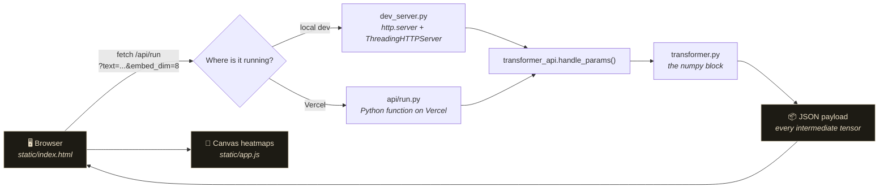
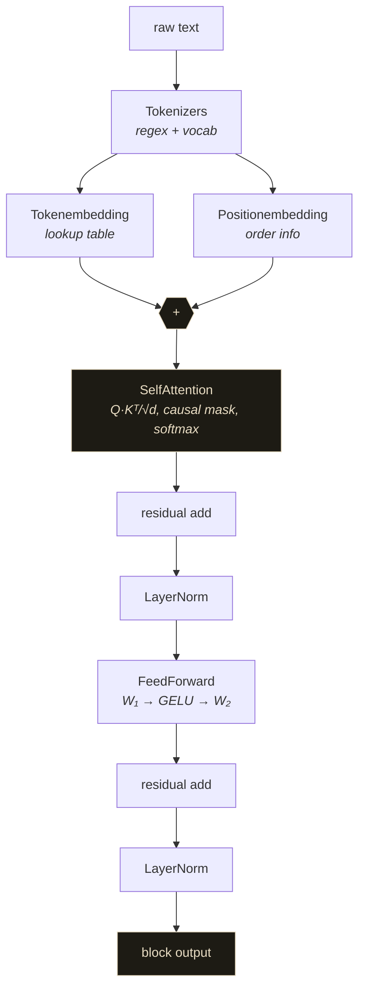

<div align="center">

# Transformer Visualizer

**A transformer block written from scratch in NumPy — with a live UI that shows you every tensor inside it.**

[Live demo](https://transformer-viz.vercel.app) · [Source](https://github.com/AKXLR8/transformer_in_numpy) · [Issues](https://github.com/AKXLR8/transformer_in_numpy/issues)

</div>

---

## What's this?

You know the transformer block from the papers — embeddings, self-attention, feed-forward, residual, LayerNorm. But reading about it and *seeing* it are two different things.

So this repo has two halves:

1. **`transformer.py`** — a single block built with nothing but NumPy. No PyTorch, no HuggingFace, no magic. Just matrices and `np.dot`.
2. **A browser UI** that runs that exact code and paints the results — the attention matrix, the embedding tables, the GELU activations, the shape of every intermediate.

Type a sentence, hit run, and watch the numbers move. Nothing is mocked up — the heatmaps are the actual NumPy arrays coming out of the actual code.

   

---

## Quick start

```bash
git clone https://github.com/AKXLR8/transformer_in_numpy.git
cd transformer_in_numpy
pip install numpy
python dev_server.py
```

Open **http://127.0.0.1:8000** and you're in.

Prefer a virtualenv? Sure:

```bash
python -m venv venv
venv\Scripts\activate        # Windows
source venv/bin/activate     # macOS / Linux
pip install -r requirements.txt
python dev_server.py
```

The server is standard library only — no Flask, no uvicorn, no `pip install` gymnastics. `dev_server.py` is about 120 lines and it runs on whatever Python 3.9+ you have lying around.

```bash
python dev_server.py --port 9000      # different port
python dev_server.py --host 0.0.0.0   # expose it on your LAN
```

---

## How it fits together



The key bit: **the browser never does the maths.** The UI is a renderer. Every pixel it draws comes from a NumPy array that was computed on the server by the same `transformer.py` you'd run from the command line. There's no second implementation to drift out of sync.

### Inside the block



Every arrow above is a tensor the UI can show you. The pipeline keeps them all around instead of throwing them away, which is the whole point.

---

## What you can play with

| Panel | What it shows |
|---|---|
| **Pipeline** | Six clickable steps with the live shape each one produces. Click to jump. |
| **Tokenizer** | Your text → tokens → vocabulary ids, plus the vocabulary itself. |
| **Token embedding** | Heatmap of the lookup table (token × dim) with the raw vectors underneath. |
| **Positional embedding** | The order table that gets added to the token vectors. |
| **Self-attention** | The seq × seq attention matrix with the causal mask hatched out, hover for exact values, a **weights / pre-softmax scores** toggle, and per-query distribution bars. |
| **Feed-forward** | GELU hidden activations and the FFN output. |
| **Residual & LayerNorm** | The final normalised tensor, with mean and variance stats (should be ~0 and ~1). |
| **Parameters** | Parameter count per component and the shape of every tensor in the block. |

Plus the knobs: **embedding dim**, **FFN hidden dim**, **max sequence length**, and a **resample weights** button to draw a fresh set of random weights.

Everything re-runs live as you type. Hover any heatmap cell for its exact value.

---

## The API

One endpoint, used by both the local server and the deployed function:

```
GET /api/run?text=hello%20world&embed_dim=8&hidden_dim=32&max_seq_len=32&seed=0
```

| Param | Default | Range | Notes |
|---|---|---|---|
| `text` | `"akshay is running the dog is barking"` | ≤ 500 chars | blank input → `400` |
| `embed_dim` | `8` | 2–64 | model width |
| `hidden_dim` | `32` | 2–256 | FFN inner width |
| `max_seq_len` | `32` | 4–256 | longer inputs get truncated |
| `seed` | `0` | 0–10000 | same seed → identical weights |

The JSON response carries every intermediate tensor, so you can poke at it in the console or reuse it elsewhere:

```jsonc
{
  "tokens": ["hello", "world"],
  "token_ids": [1, 2],
  "vocab": ["<UNK>", "hello", "world"],
  "config": { "embed_dim": 8, "hidden_dim": 32, "seq_len": 2 },
  "token_embedding":  [[...], [...]],
  "position_embedding": [[...], [...]],
  "attention_weights": [[1.0, 0.0], [0.5, 0.5]],
  "attention_scores":  [[...], [...]],
  "attention_output": [[...], [...]],
  "residual_1": [...], "norm_1": [...],
  "ffn_hidden": [...], "ffn_output": [...],
  "residual_2": [...], "norm_2": [...],
  "shapes": { "attention_output": [2, 8], ... },
  "params": { "total": 1136, ... }
}
```

---

## Deploying it free on Vercel

The UI is static, the maths needs Python — so the API lives in `api/run.py`, a
Vercel Python function, and the front end is served as static files. Vercel
maps `api/run.py` to `/api/run` automatically, which is the exact path the
front end already calls.

```json title="vercel.json"
{
  "outputDirectory": "static",
  "functions": {
    "api/run.py": { "excludeFiles": "{tests/**,venv/**,static/**}" }
  }
}
```

**To deploy:**

1. Go to [vercel.com/new](https://vercel.com/new) → **Import** the repo (`AKXLR8/transformer_in_numpy`)
2. Vercel reads `vercel.json` on its own — leave the framework preset on **Other**, build command empty, output directory `static`
3. **Deploy**. The first build installs numpy for the function, so give it a minute
4. Your URL: `https://<your-project>.vercel.app`

Every push to `main` redeploys automatically.

> **No FastAPI, no Flask, no extra dependencies.** The function is a plain
> `BaseHTTPRequestHandler` subclass, so the only thing Vercel has to install is
> numpy. `requirements.txt` is the whole dependency list.

With the CLI instead:

```bash
npm i -g vercel
vercel            # preview deploy
vercel --prod     # production
```

**How it hangs together**

| Piece | Where it lives |
|---|---|
| `api/run.py` | the Vercel function, serves `/api/run` |
| `transformer_api.py` | shared request handling used by *both* entry points |
| `static/` | the UI, served as static files |
| `transformer.py` | the numpy block — bundled with the function, imported by it |

Both the local server and the deployed function call the same
`transformer_api.handle_params()`, so they can't drift apart. (An earlier
version had two copies of the request logic and they *did* drift — one of them
threw a `NameError` on every request in production while the local one was
fine. Now there's only one copy.)

> **Why the `pyproject.toml`?**
> Vercel looks for a Python entrypoint in `app.py`, `index.py`, `server.py`,
> `main.py`, `wsgi.py` or `asgi.py` at the repo root (or in `src/`, `app/`,
> `api/`). None of those exist here, so it has to be told where the function
> lives:
>
> ```toml
> [tool.vercel]
> entrypoint = "api.run:handler"
> ```
>
> That's also why the local dev server is called `dev_server.py` rather than
> `server.py` — a root `server.py` gets picked up as the entrypoint, and
> Vercel would try to serve the whole site from it.
>
> **One manifest, not two.** Vercel's `uv` installer prefers `pyproject.toml`
> over `requirements.txt`, and if `pyproject.toml` doesn't list the
> dependencies then *nothing gets installed* and the function dies at runtime
> with `No module named numpy` (vercel/vercel#14041). So `pyproject.toml`
> lists numpy, `uv.lock` pins it, and `requirements.txt` stays around for
> local development. Committing the lockfile keeps the build reproducible.

**One heads-up:** Netlify was the original plan, but Netlify Functions only
support TypeScript, JavaScript and Go — there's no Python runtime there at
all. Vercel runs Python natively, so the block stays in Python, which is the
whole point.

Free tier: 100 GB bandwidth, 1000 build minutes, and the Hobby plan's
serverless function allowance is plenty for a demo. Cold starts are around a
second.

---

## Tests

```bash
python -m unittest discover -s tests -v
```

36 tests covering the bits that are easy to get quietly wrong:

- attention rows sum to 1, stay non-negative, and the causal mask is exactly zero above the diagonal
- residuals, LayerNorm, GELU and the FFN match independent re-implementations
- final LayerNorm really is standardised (mean ≈ 0, variance ≈ 1)
- softmax doesn't blow up on huge logits
- the same seed always gives the same weights, different seeds don't
- edge cases: empty input, whitespace, punctuation only, one word, 200 words, unicode, emoji, `d=2`, `d=64`, `hidden=256`
- the JSON contract the UI depends on
- the deployed API: status codes for blank/wordless input, parameter clamping, the 500-char cap, and a key-by-key check that every field `app.js` reads is actually in the response

---

## A few honest notes

Things that might trip you up if you don't know about them:

**Attention looks uniform.** Every row is exactly `1/n`, no matter what you type. That's not a bug — the weights are random and tiny (~0.02), so `Q·Kᵀ/√d` lands around zero and softmax flattens out. Flip the toggle to **Pre-softmax scores** to see the (very small) real differences. If you want attention that actually varies, scale up the embedding init or add a temperature knob.

**The vocabulary is rebuilt from your input on every request.** So the vocabulary size changes with the sentence, and `<UNK>` can never actually fire — the vocabulary always contains every word you just typed. To demo UNK behaviour you'd need a fixed corpus vocabulary.

**The tokenizer is a regex, so it splits hard.** `\b\w+\b` means `don't` → `don` + `t`, `3.14` → `3` + `14`, `well-known` → `well` + `known`, and emoji get dropped entirely. `café` survives fine.

**Input is capped** at 500 characters and the sequence at `max_seq_len`. Both are surfaced in the UI rather than failing silently.

**There's a lock around the weight init.** `np.random.seed()` is process-global state, and both the threaded local server and Lambda handle requests in parallel — without the lock, two simultaneous requests interleave their random draws and quietly produce different weights than the same seed should. This one bit us during the audit: 8 out of 8 seeds diverged under load. Now they all reproduce exactly.

---

## Project layout

```
transformer.py                 the block, in pure NumPy (342 lines)
transformer_api.py             shared request handling (78 lines)
dev_server.py                  stdlib HTTP server for local dev (122 lines)
api/run.py                     the deployed function: /api/run (50 lines)
api/__init__.py                makes api.run importable as a module
pyproject.toml                 entrypoint + dependencies for Vercel
uv.lock                        pinned dependency versions
vercel.json                    output dir + function config
requirements.txt               numpy (local dev)
.python-version                3.12
static/
  index.html                   the page
  styles.css                   pitch-black theme, cream accent, mixed serif/sans
  app.js                       rendering, heatmaps, interaction (777 lines)
tests/
  test_pipeline.py             math invariants + edge cases (138 lines)
  test_function.py             the API + JSON contract (165 lines)
```

The front end is deliberately dependency-free — no React, no build step, no `node_modules`. It's plain HTML, CSS and one JavaScript file. Clone the repo, run the server, done.

---

## Credits

Built while learning transformers from scratch. The block follows the original
[Attention Is All You Need](https://arxiv.org/abs/1706.03762) paper, minus everything
that isn't the point for a single block: no multi-head splitting, no dropout, no
training loop, no positional encoding beyond the learned table.

<div align="center">
  <sub>Built while learning transformers from scratch · no frameworks, just NumPy and stubbornness</sub>
</div>
